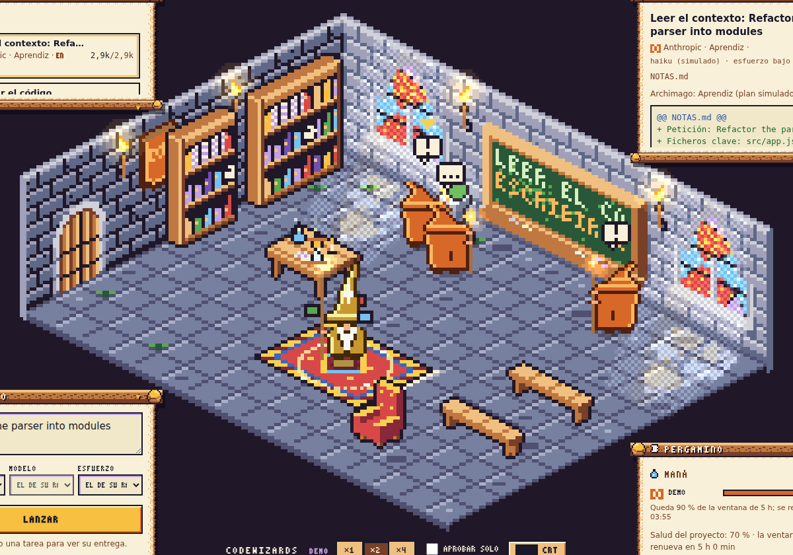

<p align="center">
  
</p>

<h1 align="center">CodeWizards</h1>

<p align="center"><strong>Do not vibecode. Spellcode.</strong></p>

<p align="center">
  <a href="https://github.com/poligle/codewizards/actions/workflows/ci.yml"></a>
  <a href="https://github.com/poligle/codewizards/actions/workflows/secrets.yml"></a>
  <a href="LICENSE"></a>
  <a href="codewizards-art/LICENSE"></a>
</p>

CodeWizards is an open-source local app, in development, that turns the AI coding agents you already use into a tower of pixel-art wizards in the style of the Game Boy Color. A small process on your computer drives the official agent CLIs with your own accounts and opens the room in your browser, so your work spends the plan limits or free quotas you already have instead of pay-per-token credit. Each project is a room, each agent is a wizard, and every action is a spell you can see, approve and audit.

> **Status: v1.7.0.** The room now runs on a local core: `codewizards demo` with simulated wizards, and an experimental `codewizards serve` that drives your own Claude Code on a repository. It is not on npm yet ([changelog](CHANGELOG.md)).
> [Try the demo](https://poligle.github.io/codewizards/): simulated agents, interface still in Spanish.

## How it will work

1. **Cast a spell.** Write a request. The Archmage gives it a rank and a model (Apprentice, Young Mage or Grand Sage) by the size of the job and the quota left, or you choose. Later it will split big spells into tasks and spread them over your accounts.
2. **Watch the wizards.** Each task runs in its own branch of your GitHub repository through an official CLI. Wizards read at the library, write at the lab table and present at the blackboard.
3. **Review on the blackboard.** You see the diff. Approve it and it is committed to the task's branch, with a draft pull request if you want one; reject it and the wizard goes back to the table with your comment.
4. **Mind the mana.** Mana is the quota left in each connected account. Every event is logged and can be replayed.

## Principles

- **Your accounts, your machine.** CodeWizards has no server and no sign-up. Official CLIs sign in with their own flows, and CodeWizards never stores or relays your keys, tokens or code. The core listens on 127.0.0.1 only, with a fresh token each run, and makes no network requests of its own.
- **Control over vibes.** An estimate before each spell, real usage after it, and nothing goes in without your approval.
- **Open source.** Code under MIT and art under CC BY 4.0. A download page at `codewizards.app` comes with the first release.

## Roadmap

| Milestone | What | Status |
| --- | --- | --- |
| 0 · Mockup | GBC room, spell book and blackboard with simulated agents | Done · v1.0 |
| 1 · Specialisation | Steps 1 to 7 polish their parts on the mockup | In progress · steps 1 and 2 done (v1.1, v1.2) |
| 2 · Local app | Local core with the room in the browser, CI with a browser smoke test and a test package | In progress · core, CI and test package in v1.2 |
| 3 · Claude, for real | Claude Code with the user's own Claude account | — |
| 4 · More accounts | Codex, Google's CLI and others, routed by remaining quota | — |
| 5 · Launch | Download page at `codewizards.app`, desktop app decision, launch plan and published release | — |

## Run it locally

You need Node 22 or newer and git. For `serve`, also [Claude Code](https://code.claude.com/docs), installed and signed in with your own account. With Nix, `nix develop` gives you node, npm, git and the Python the art needs.

```sh
git clone https://github.com/poligle/codewizards && cd codewizards
nix develop                                            # optional, with Nix
npm ci --ignore-scripts
node apps/core/bin/codewizards.js                      # La Torre: your rooms, enter one or found a new one
node apps/core/bin/codewizards.js demo                 # the room with simulated wizards
node apps/core/bin/codewizards.js doctor               # checks node, git, gh and claude
node apps/core/bin/codewizards.js serve --repo PATH    # experimental: your Claude Code on PATH
```

The room opens at `http://127.0.0.1:PORT/#token=…`; keep that address to yourself. Caps, sandbox and data folders are described in [`docs/arquitectura.md`](docs/arquitectura.md) (in Spanish).

## Workflow

What happens when you cast a spell in `codewizards serve --repo PATH`. The repository needs at least one commit, because each task branches from it. It needs nothing from Claude Code inside it: your Claude Code login lives in your home folder, not in the repository.

1. **A copy for the wizard.** CodeWizards creates the branch `cw/t1-<name>` from your current commit and a separate working copy of it (a git worktree) in its own data folder. Your checkout is not touched while the wizard works.
2. **The wizard works.** The Archmage picks its rank and model (or you pick in the spell book), and your Claude Code runs in that copy, signed in with your own account. It can read and edit files. It can only run `git status`, `git diff`, `git log` and the command you allow with `--test-command`, inside Claude Code's sandbox. It cannot push or reach the network. Anything denied shows up in the scroll.
3. **The blackboard.** When it finishes, you see the real diff of the copy against your commit, and the model that did it.
4. **You decide.**
   - **Reject** with a comment: the same Claude Code session picks it up again in the same copy.
   - **Approve**: the change is committed to `cw/t1-<name>` and the copy is removed. Your branch does not move: the blackboard offers **Merge into my branch** (a fast-forward, never forced) and shows the `git merge` that does the same. Start `serve` with `--merge` to fast-forward on approval, or with `--open-prs` to push the branch and open a draft pull request with your own `gh`.
   - **Stop**: the wizard is stopped; its branch stays for you to look at.
5. **Who pays.** Your Claude plan, whose usage limits Claude Code shares with your chats. The mana bar is what is left of your five-hour window, as Claude Code reports it. When it runs out, the wizard does not leave: it waits in the armchair until the window resets and then carries on. If `ANTHROPIC_API_KEY` or `ANTHROPIC_AUTH_TOKEN` is set, CodeWizards leaves it out so the plan pays; `--use-api-key` bills the API instead. If you turned on extra usage in your Claude account, work past the plan's limit is billed at API rates.

The Archmage's table lives in `ranks.json`: for each rank a model and an effort (Apprentice `haiku` at low effort, Young Mage `sonnet` at medium, Grand Sage `opus` at high: aliases that pick the newest model your Claude Code supports, shown in the room), its turns and a short system note. Change it in `~/.config/codewizards/ranks.json`, or pick the model and the effort for one spell in the spell book. The tasks panel has what is in progress, what is done (the history), a notes editor for what is still to do, and a read-only explorer of the repository's committed files. Leftovers are ordinary git: `git branch -D cw/t1-<name>` and `git worktree prune`. `--record` keeps each turn's raw output, with known secret formats masked, next to the room's log, to turn real runs into test recordings.

## Repository layout

| Path | Contents |
| --- | --- |
| `apps/room/` | The room (formerly the mockup): `src/` is served as is (world, simulator, renderer, interface, live link); `build.py` exports the art to `src/assets.gen.js`; `test/` |
| `apps/core/` | The local core: the `codewizards` command, the local server, the event log, the rooms (demo and Claude Code), the adapters and their tests |
| `packages/contract/` | Event contract v2 as code, with its validator |
| `evals/` | The Archmage's evals: 20 small tasks with hidden tests (in Spanish: `evals/README.md`) |
| `tools/smoke.mjs` | Browser smoke test (Playwright, Chromium) |
| `codewizards-art/` | GBC-style pixel art painted by code and retouched by hand: assets, palettes, `meta.json` and the generator in `04_source/` |
| `docs/` | `agentes.md` (development plan, event contract and agent prompts), `arquitectura.md` (architecture), `concepto/` and `img/`; in Spanish |
| `auditorias/` | Step reports and the hand-off log, in Spanish |
| `licenses/` | Third-party components and their licenses |
| `.github/` | CI (art, room, core on Linux, macOS and Windows, smoke test), demo deploy to Pages, secret scan and Dependabot |

The first art round, in SNES style, was retired in v1.1 and lives in tag [`v1.0`](https://github.com/poligle/codewizards/tree/v1.0/codewizards-art/legacy/snes-ronda1).

## Event contract v2

The room knows nothing about LLMs: it only replays events (`room.opened`, `task.created`, `agent.summoned`, `agent.assigned`, `context.read`, `code.write`, `command.run`, `command.denied`, `artifact.present`, `tokens.used`, `quota.updated`, `review.requested`, `review.approved`, `review.rejected`, `agent.error`, `agent.blocked`, `agent.unblocked`, `task.done`, `task.merged`, `task.failed`, `task.cancelled`, `agent.idle`). The simulator and the Claude Code adapter emit the same ones, and the core checks every event against `packages/contract/contract.js` before it stores or sends it. Each event carries a sequence number, so replaying the log never doubles anything. Full table in `docs/agentes.md`.

## Development

```sh
nix develop                                      # optional: node, npm, git, Python with numpy and Pillow, and `codewizards` on the PATH
npm ci --ignore-scripts                          # ws, plus Playwright for the smoke test
npm test                                         # core, contract and room tests
npx playwright install chromium && npm run smoke # the room in a real browser
node tools/evals.mjs --self-check                # the eval bank (see evals/README.md before a real run)
nix develop .#smoke -c npm run smoke             # the same on NixOS, with nixpkgs' Chromium
python3 -m pip install -r codewizards-art/04_source/requirements.txt   # numpy, Pillow
python3 codewizards-art/04_source/gen/build.py   # regenerate art, previews and the art demo
python3 codewizards-art/04_source/gen/check.py   # validate art: format, palettes, colours, names, orphans
python3 apps/room/build.py                       # export the art to apps/room/src/assets.gen.js
```

CI runs the art check, the room tests and the `assets.gen.js` check, the core tests on Linux, macOS and Windows, and the smoke test on the package installed as a user would. Pages publishes only the room demo. A separate workflow scans the whole history for secrets.

## Conventions

- The product, commit messages and READMEs are in English; plans, reports and hand-offs are in Spanish.
- Each delivery comes as a git patch, applied with `git am`, so that deleted files are deleted too; it also brings its `COMMIT_MSG.txt` (git-ignored).
- Releases are automatic: when a push to main brings a new version in `package.json`, CI tags it and publishes a GitHub release with its CHANGELOG section and the package.
- No key, token or secret ever goes into the repository.
- Art is painted by code, without generative image models, and retouched by hand. Integer scaling only (`image-rendering: pixelated`).

## License

- Code: [MIT](LICENSE).
- Art: [CC BY 4.0](codewizards-art/LICENSE). This covers `codewizards-art/`, the art exported to `apps/room/src/assets.gen.js` and the images in `docs/img/` and `auditorias/img/`.
- Third-party components: [`licenses/`](licenses/README.md).
- The CodeWizards name and logo are not licensed.

CodeWizards is an independent project, not affiliated with or endorsed by Anthropic, OpenAI, Google, GitHub, DeepSeek, Alibaba Cloud or Meta. Their names only identify the models and tools that a guild or an account uses.
