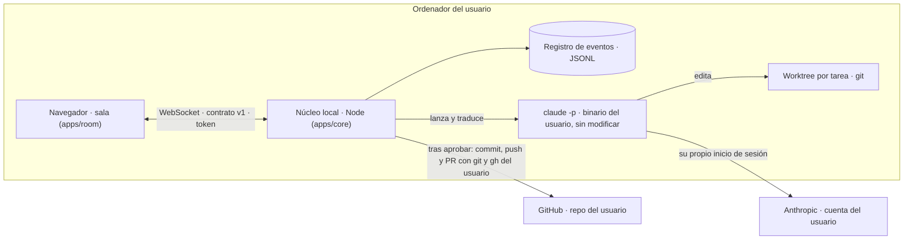

# Arquitectura de CodeWizards

22/10/2026 · Paso 2 (arquitectura y software, fase A) · v1.2. Informe del paso: `auditorias/software.md`.

## 1. En una página

CodeWizards es un proceso local en Node que dirige los CLI oficiales de agentes con las cuentas del usuario y sirve la sala, una página web, al navegador del propio usuario. La sala solo reproduce eventos del contrato; el núcleo los produce, los valida y los guarda.



Principios, todos con su prueba en la CI:

1. **Sin servidor propio ni credenciales.** El núcleo no lee, guarda ni reenvía claves o tokens; cada CLI usa su propio inicio de sesión.
2. **Nada entra sin revisión.** El agente nunca hace commit, push ni PR; la aprobación en la pizarra es la única puerta. Fuera de la demo no existe la aprobación automática.
3. **La sala solo reproduce eventos.** Simulador y adaptadores emiten el mismo contrato, validado en el núcleo.
4. **Sin red propia.** El núcleo solo escucha en 127.0.0.1; las únicas conexiones salientes son las de los CLI del usuario (`claude`, `git`, `gh`).

## 2. Carpetas

| Ruta | Qué es |
| --- | --- |
| `apps/room/` | La sala (antes la maqueta): `src/` se sirve tal cual (sin build); `build.py` genera `src/assets.gen.js` desde el arte; `test/` |
| `apps/core/` | El núcleo: `bin/codewizards.js` (CLI), `src/` (servidor, registro, salas, adaptadores, git) y `test/` (con un Claude Code falso y grabaciones) |
| `packages/contract/` | El contrato de eventos v1 en código (`contract.js`) y sus tests |
| `tools/smoke.mjs` | Prueba de humo en Chromium con Playwright |
| `codewizards-art/` | Arte GBC y su generador; `check.py` también falla ante huérfanos |
| `docs/`, `auditorias/` | Plan, contrato, esta arquitectura e informes |

El paquete npm es la raíz del repo (`package.json`): publica `apps/core`, `apps/room/src`, `packages/contract/contract.js` y las licencias. Hoy es `private` hasta que Pol decida publicarlo (§12).

## 3. El núcleo local y su seguridad

`codewizards demo` (simulador, sin CLI ni cuenta), `codewizards serve --repo RUTA` (Claude Code, experimental: hito 3) y `codewizards doctor` (comprueba node, git, gh y claude sin leer credenciales).

El núcleo controla agentes que escriben código, y cualquier web que visite el usuario puede intentar llegar a un puerto de 127.0.0.1. Por eso:

| Amenaza | Defensa | Prueba |
| --- | --- | --- |
| Otra máquina de la red | Escucha solo en 127.0.0.1, puerto aleatorio | `server.test.js` |
| DNS rebinding (una web resuelve su dominio a 127.0.0.1) | Toda petición necesita `Host` 127.0.0.1:PUERTO o localhost:PUERTO | `server.test.js` |
| Secuestro del WebSocket desde otra web | `Origin` obligatorio de 127.0.0.1 o localhost y token aleatorio de 24 bytes por ejecución, ofrecido como subprotocolo `cw.token.<token>` (nunca en una query) | `server.test.js`; humo C, desde otro origen y con el token |
| Fuga del token | Va en el fragmento de la URL (no llega a ningún servidor); la sala lo quita de la barra al cargar; el servidor nunca lo devuelve | humo C |
| Inyección en la sala | Solo se sirven los ficheros de la sala; CSP `default-src 'none'; script-src 'self'`; todo dato de un evento se escapa | `server.test.js`; humo |
| Órdenes malformadas | Lista blanca de órdenes con tamaños máximos; mensajes de 64 KB como mucho | `server.test.js` |
| Eventos rotos de un adaptador | Validación del contrato antes de guardar o emitir; un evento inválido se rechaza entero | `store.test.js` |
| Secretos en diffs o mensajes | Filtro de formatos conocidos antes de guardar (`redact.js`) | `redact.test.js` |

Fuera del modelo: otros procesos del mismo usuario (pueden leer su disco igualmente) y las extensiones del navegador.

## 4. Contrato de eventos v1

La tabla está en `docs/agentes.md` («Contrato de eventos v1») y la verdad ejecutable en `packages/contract/contract.js`. En la implementación:

- El registro (`store.js`) es el único que pone `seq` (1, 2, 3… por sala), `v` y `room`. Los adaptadores entregan borradores.
- `ts` es la hora del hecho en milisegundos de época. El pergamino la muestra relativa al primer evento.
- La sala ignora un evento con `seq` ya visto, así que reconectarse o reproducir el registro no duplica nada. Al conectar, el cliente envía `{"cmd":"hello","since":<último seq>}` y recibe lo que le falta.
- Los huecos se toleran: un evento de trabajo de un agente que la sala no ha visto lo hace entrar por la puerta.
- Un gremio desconocido se pinta con la paleta neutra `unknown` (los grises del muro, ya dentro de la paleta GBC).
- `account` es un identificador local y opaco (`claude-code`, `demo`): nunca un correo ni una credencial.

## 5. Adaptadores

Un adaptador lanza un CLI oficial **sin modificar**, traduce su salida a borradores del contrato y dice cómo terminó el turno. No toca credenciales y no copia salidas crudas de herramientas en los eventos.

**Claude Code** (`apps/core/src/agents/claude-code/`):

- Lanza el `claude` del usuario. Si no hay `claude` en el PATH, `CW_CLAUDE_BIN` indica otro. En Windows solo vale el `claude.exe` nativo, porque `claude.cmd` obliga a pasar por `cmd.exe`.
- Línea de órdenes (`policy.js`):
  - `-p --output-format stream-json --verbose`
  - `--session-id <uuid>`, o `--resume <uuid>` tras un rechazo
  - `--permission-mode dontAsk`, `--tools`, `--allowedTools` y `--disallowedTools`
  - `--max-turns` y, si se pide, `--max-budget-usd`
  - `--settings` con un fichero propio de la tarea, para no tocar la configuración del usuario
  - `--append-system-prompt` con las reglas del worktree
- **El hechizo entra por stdin**, nunca como argumento, así que no pasa por ninguna shell ni línea de órdenes. Nunca se usan `--bare` ni `--dangerously-skip-permissions`.
- Traducción (`translate.js`):

  | Claude Code | Contrato |
  | --- | --- |
  | `tool_use` Read, Grep o Glob (los de un mensaje, juntos) | `context.read` |
  | `tool_use` Edit, Write, MultiEdit o NotebookEdit | `code.write` (con un diff corto) |
  | `system/api_retry` `rate_limit` o `billing_error` | `agent.blocked` (quota) y `quota.updated` (limited) |
  | `system/api_retry` `authentication_failed` | `agent.blocked` (auth) |
  | el siguiente mensaje del asistente | `agent.unblocked` |
  | `result` | `tokens.used` (input = entrada + escritura de caché; cache = lectura de caché), un `agent.error` por permiso denegado, y el desenlace del turno |
  | `result` con `error_max_turns`, `error_max_budget_usd` o `error_during_execution` | `task.failed` (`max_turns`, `budget`, `error`) |

- La sala añade `agent.summoned`, `agent.assigned`, `artifact.present` (el `git diff` real del worktree), `review.*`, `task.*` y `agent.idle`.
- Versiones: `system/init` trae `capabilities` en las versiones recientes; el adaptador lo guarda para detectar funciones en lugar de comparar números de versión.
- Riesgos conocidos (detalle y fuentes en `auditorias/software.md` §2):
  - Anthropic anuncia que `--bare` será el modo por defecto de `-p` y que ese modo no usa la sesión de la suscripción.
  - El cambio de facturación de `claude -p` con suscripción está pausado, no descartado.
  - No está verificado si `--max-budget-usd` corta con suscripción.
  - El texto que marca «límite de uso agotado» es una heurística sin verificar.

**Siguientes CLI (hito 4)**: Codex y el CLI de Google. Cada uno con su carpeta en `agents/`, su traductor puro y sus grabaciones; no se han estudiado todavía en detalle.

## 6. Credenciales

- CodeWizards no lee `~/.claude`, el llavero del sistema ni variables de entorno de claves: lanza el CLI con el entorno del usuario tal cual y nunca lo registra.
- Para saber si hay sesión usa `claude auth status` y se queda solo con el código de salida. El JSON, que puede llevar el correo, se descarta.
- Sin sesión, `serve` y `doctor` piden al usuario que ejecute `claude` e inicie sesión él mismo. Las claves de API opcionales se configuran en cada CLI, no en CodeWizards.
- `git` y `gh` usan las credenciales que el usuario ya tenga.
- Pendiente de Pol: aceptar los términos comerciales de Anthropic antes de distribuir la primera versión que ejecute Claude Code (§12 y `auditorias/software.md` §5).

## 7. Ejecución del código de los agentes

Capas, de fuera adentro:

1. **Worktree por tarea**, fuera del checkout del usuario (en la carpeta de datos). El checkout no cambia hasta que el usuario fusiona.
2. **Permisos de Claude Code en `dontAsk`**: se deniega todo lo que no esté permitido, sin preguntar.
   - Permitido: Read, Grep, Glob, Edit, Write, MultiEdit, NotebookEdit; `git status`, `git diff *` y `git log *`; y el comando de tests de `--test-command`, que solo admite órdenes simples, sin comillas, `;` ni tuberías.
   - Denegado expresamente: `git push`, `gh`, `curl`, `wget`, WebFetch y WebSearch.
3. **Sandbox de sistema de Claude Code para Bash**: Seatbelt en macOS y bubblewrap en Linux.
   - `enabled` y `failIfUnavailable`: si el sandbox no arranca, la tarea falla en vez de seguir sin él.
   - `allowUnsandboxedCommands: false`: sin vía de escape.
   - Sin dominios de red permitidos.
   - `--no-sandbox` lo quita, con un aviso al arrancar.
4. **Topes** (§10) y el botón de parar, que mata el grupo de procesos entero (`taskkill /T` en Windows).
5. **Contenedor opcional**: más adelante, para quien quiera aislar también la lectura del disco.

**Windows nativo** (decisión de Pol): sin Bash, porque el sandbox de Claude Code exige WSL2. Los magos leen y editan, pero no ejecutan órdenes.

## 8. GitHub: ramas, worktrees y PR

1. Hechizo → tarea `tN` → rama `cw/tN-<slug>` desde el HEAD actual, en `<datos>/rooms/<sala>/worktrees/tN`.
2. Turno de Claude Code → diff contra la base → pizarra (`artifact.present`, `review.requested`).
3. **Aprobar** → commit en la rama con la identidad git del usuario.
   - Con `--open-prs`, además, `git push` y `gh pr create --draft`, y la URL del PR viaja en `task.done`.
   - Después se quita el worktree; la rama queda.
4. **Rechazar** → el comentario vuelve a la misma sesión (`--resume`) en el mismo worktree.
5. Si una tarea falla o se cancela, su rama y su worktree quedan para inspeccionarlos (`git worktree prune` limpia lo que borres a mano).

## 9. Datos locales

| Sistema | Carpeta (o `CODEWIZARDS_HOME`) |
| --- | --- |
| Linux | `$XDG_DATA_HOME/codewizards` o `~/.local/share/codewizards` |
| macOS | `~/Library/Application Support/CodeWizards` |
| Windows | `%LOCALAPPDATA%\CodeWizards` |

Dentro: `rooms/<sala>/events.jsonl` (permisos 0600), `rooms/<sala>/worktrees/` y `rooms/<sala>/tasks/<tarea>/claude-settings.json`.

- La sala de un repo se llama `<nombre>-<8 hex del hash de su ruta>`.
- La demo no guarda nada salvo con `--log`.
- No se registran salidas crudas de herramientas ni el entorno.
- No hay telemetría.

## 10. Topes (provisionales; el paso 3 los calibra con medidas)

| Tope | Valor | Opción |
| --- | --- | --- |
| Magos a la vez por sala | 2 | `--max-agents` |
| Tareas por sesión | 20 | `--max-tasks` |
| Turnos por tarea | 40 | `--max-turns` |
| Tiempo por turno | 30 min | `--timeout-min` |
| Tokens por sala (entrada + salida) | 2.000.000 | `--room-tokens` |
| Coste por turno | sin tope | `--max-budget-usd` (sin verificar con suscripción) |

Al pasar un tope, la tarea termina con `task.failed` y `reason: cap` o `timeout`, visible en la sala y en el registro.

## 11. Pruebas

| Capa | Qué | Dónde |
| --- | --- | --- |
| Contrato | Validador: tipos, campos, envoltorio y borradores | `packages/contract/test/` |
| Sala | Rutas, simulador contra el contrato v1, hechizo completo, idempotencia, huecos, gremio desconocido y eventos v1 | `apps/room/test/room.test.mjs` |
| Núcleo | Registro, redacción, servidor (Host, Origin, token, CSP, reconexión), traductor con grabaciones, ejecución con un Claude Code falso, git real en repos temporales y la sala de Claude Code de punta a punta | `apps/core/test/` |
| Navegador | Chromium: demo estática a ×3, móvil a ×1 y la sala servida por el núcleo instalado desde el paquete; sin errores, sin peticiones fuera de la máquina, CRT recordado, token fuera de la barra y otro origen rechazado | `tools/smoke.mjs` |
| Arte | `check.py`, ahora también con huérfanos | `codewizards-art/04_source/gen/check.py` |

La CI ejecuta el núcleo en Linux, macOS y Windows, y la prueba de humo sobre el paquete empaquetado e instalado como lo haría un usuario. Las grabaciones de Claude Code son sintéticas hasta que Pol grabe las reales en el hito 3 (`apps/core/test/fixtures/claude-code/README.md`).

En local:

```sh
npm ci --ignore-scripts
npm test                                  # núcleo, contrato y sala
npx playwright install chromium && npm run smoke
python3 codewizards-art/04_source/gen/check.py
python3 apps/room/build.py --check
```

## 12. Empaquetado, distribución y actualizaciones

**Fase 1, hitos 2 a 4 (decisión de Pol): proceso local y sala en el navegador.**

- Distribución:
  - Paquete npm `codewizards` (Node 22 o superior): `npx codewizards demo`. El nombre estaba libre en npm el 22/10/2026.
  - El tarball, en cada release de GitHub.
  - `codewizards.app`, estática, explica cómo instalarlo y enlaza las notas.
- Publicación: con *trusted publishing* desde GitHub Actions (OIDC, con procedencia) y sin token de npm guardado; la prepara el paso 9.
- Actualizaciones: el núcleo no comprueba versiones por su cuenta, porque no hace peticiones de red; se actualiza con npm y lo anuncian las notas de versión.

**Fase 2, hito 5: aplicación de escritorio.** Se decide midiendo sobre el mismo protocolo, sin reescribir el núcleo:

| Opción | A favor | En contra |
| --- | --- | --- |
| Tauri 2 con el núcleo como *sidecar* | Instaladores pequeños; IPC sin puerto local | Rust y vistas web distintas por sistema (WebKitGTK en Linux) |
| Electron | El núcleo corre dentro tal cual | Mucho más pesado |

Antes de decidir, hay que verificar el coste de las firmas (Apple Developer ID con notarización, y firma de código en Windows).

## 13. Cómo añadir…

**Un evento.**

1. Pide el «adelante» de Pol (cambia el contrato y sube `v`).
2. Añádelo en `packages/contract/contract.js` y en la tabla de `docs/agentes.md`.
3. Haz que lo emitan el simulador (`apps/room/src/sim.js`) y el adaptador que corresponda.
4. Dale comportamiento en `world.js` (sala) y en `ui.js` (paneles).
5. Tests: validador, `room.test.mjs` y el traductor con una grabación.

**Un gremio.**

1. Pide el «adelante» de Pol (marca y arte).
2. Añade su id de fabricante a `GUILDS` en el contrato.
3. Pídele al paso 6 su paleta en `gbc.py` (dentro de las 8 de sprites) y añádela a `CONTRACT_GUILDS`, `NAMES` y el emblema de `apps/room/build.py`.
4. `python3 apps/room/build.py` y `check.py`.

**Una cuenta (un CLI).**

1. Crea `apps/core/src/agents/<cli>/` con:
   - `check.js`: instalado y con sesión, solo por código de salida;
   - `policy.js`: la política de ejecución traducida a sus opciones de permisos y sandbox;
   - `translate.js`: puro, de su salida al contrato;
   - `runner.js`: el prompt por stdin, si lo admite.
2. Añade grabaciones en `test/fixtures/<cli>/` y un modo en el CLI falso.
3. Revisa los términos del proveedor (`auditorias/producto.md` §6.1).
4. El `account` es un id local nuevo.

**Un rango.**

1. Pide el «adelante» de Pol.
2. Añádelo a `RANKS`, a su sprite en `gbc.py` y al atlas de `apps/room/build.py` y `render.js`.
3. Pon su modelo en la tabla configurable del paso 3: ningún nombre de modelo fijo en el código.

**Un asset.**

1. Píntalo en el generador (`codewizards-art/04_source/gen/gbc.py`), con colores dentro de las paletas GBC.
2. `build.py` lo anota en `meta.json`.
3. `check.py` en verde: un PNG que no esté en `meta.json` hace fallar el check.
4. Si la sala lo usa, expórtalo en `apps/room/build.py`.

**Una pantalla.**

1. HTML en `apps/room/src/index.html` y lógica en un fichero nuevo de `src/`, cargado con `<script src>` (la CSP no admite scripts en línea).
2. Añade el fichero a la lista de `apps/core/src/server.js` (`FILES`) y al `cp` de `.github/workflows/pages.yml`.
3. Los textos, en el objeto `T`.
4. Una comprobación en `tools/smoke.mjs`.

## 14. Decisiones

| # | Decisión | Estado |
| --- | --- | --- |
| 1 | Proceso local en Node con la sala en el navegador; escritorio en el hito 5 | Aceptada por Pol (paso 2) |
| 2 | Contrato v1 (`seq`, `ts` de época, `account`, gremios por fabricante, eventos nuevos) | Aceptada por Pol (paso 2) |
| 3 | Adaptador de Claude Code por el modo headless (`-p`, stream-json) y no por el Agent SDK ni por una terminal virtual | Propuesta del paso 2; se revisa si `--bare` pasa a ser el defecto |
| 4 | Windows nativo sin Bash | Aceptada por Pol (paso 2) |
| 5 | Pages con un workflow propio que publica solo la demo | Aceptada por Pol (paso 2) |
| 6 | Entregas como parche de git, no copiando ficheros | Aceptada por Pol (paso 2) |
| 7 | JavaScript sin paso de build, con módulos ES en el núcleo y scripts clásicos en la sala (para que funcione desde `file://`) | Paso 2 |
| 8 | Comprobación de tipos con JSDoc y `tsc` | Pendiente: no se hizo en este paso |
